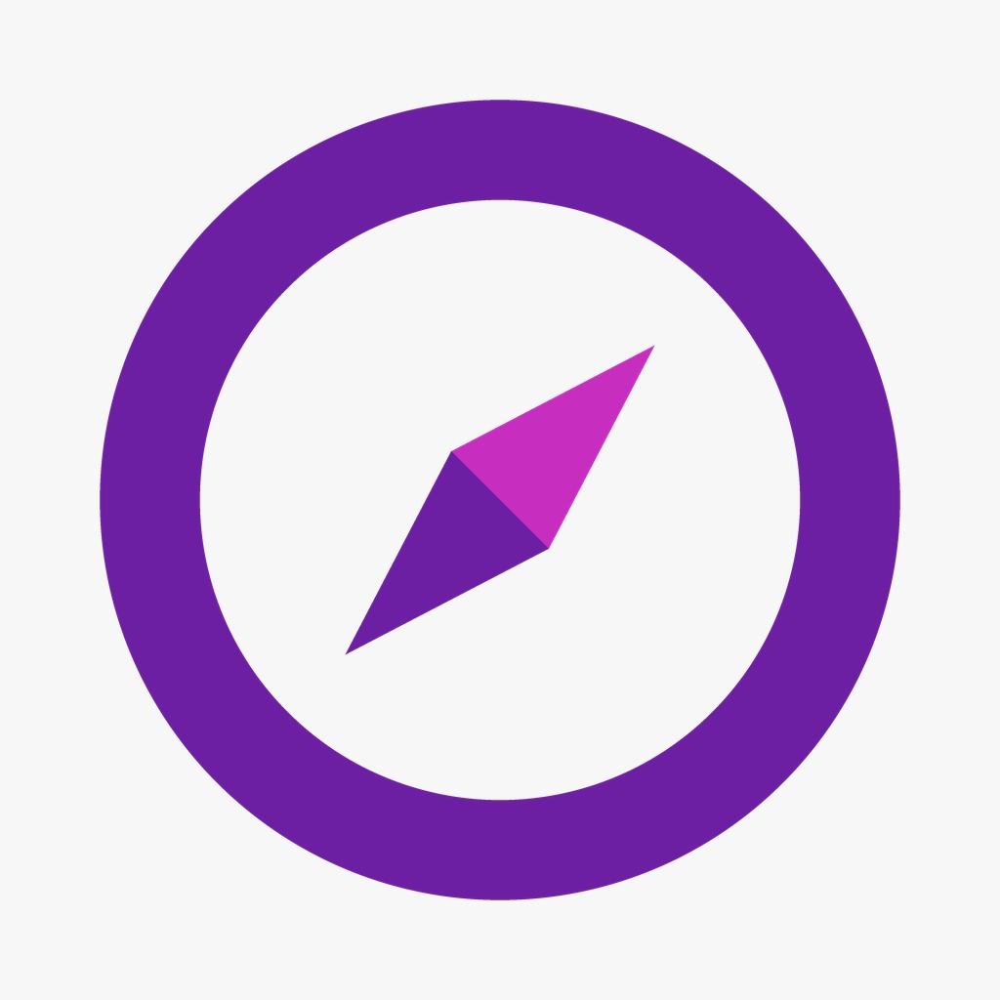

  
<!-- Lembrar de colocar aqui o link do figma e outros --!>

<h1>Instituto R.U.M.O.</h1>

<strong> Rede de Upskilling, Mentoria e Oportunidades </strong>

<!-- aqui o link do site --!>

---
## 🟣Sobre o projeto
O **Instituto R.U.M.O. (Rede de União, Mentoria e Oportunidades)** é uma plataforma digital criada para combater o etarismo profissional e valorizar profissionais com 40 anos ou mais.

Diante das dificuldades enfrentadas por esse público no mercado de trabalho, a plataforma oferece acesso a cursos, mentorias e oportunidades profissionais, incentivando o desenvolvimento de novas competências e a inclusão no ambiente corporativo.

## 📍Funcionalidades

---
## 🛠️Tecnologias utilizadas

## 📱Imagens das telas

## ▶️Como executar

## 👥Nossa equipe
- **Adrielli Gomes** - (Adicionar função)
- **Gustavo Henrique** - (Adicionar função)
- **Luysa Rocha** - (Adicionar função)
- **Maria Elani** - (Adicionar função)
- **Kemilly Campos** - (Adicionar função)
- **Thomas Pires** - (Adicionar função)
